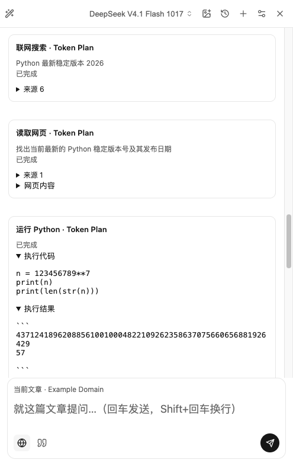
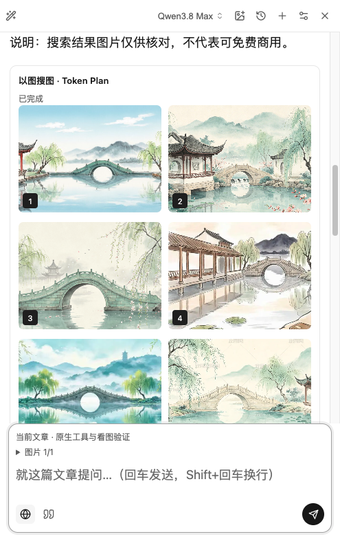

# Token Plan 界面验证

验证日期：2026-10-25。基线为官方 1.19.0（`cbd122c`）。

## 触发场景与变化

用户已经配置 Token Plan 的模型地址与密钥，但没有额外配置 Brave Search / DeepSeek Search。旧路径只发送普通聊天请求，并依赖扩展单独配置的搜索服务；模型服务本身提供的工具没有被交给模型使用。

在官方 1.19.0 中，请求「实际联网查询 Python 最新稳定版本，并提供官方来源；没有搜索工具就明确说明」后，实际回答为：

> 没有联网：当前网页搜索服务未配置，无法实际查询。

此 PR 为明确识别的 Token Plan 模型选择 Responses API，用原有模型密钥声明服务商支持的原生工具，并展示真实执行记录。

| 场景 | 官方 1.19.0 的原调用路径 | 本 PR 的原生调用路径 |
|---|---|---|
| 未填写额外搜索密钥 | 搜索提示先连接服务 | 使用同一模型密钥执行 `web_search` |
| 读取公开网页 | 依赖单独搜索服务 | 使用 `web_extractor`，保留来源与读取结果 |
| 精确计算 | 仅有模型文字回答，不是 Python 执行证据 | 显示 `code_interpreter` 实际代码与输出 |
| 文搜图 / 以图搜图 | 未接入 Token Plan 两项图片工具 | 支持的 Qwen 模型显示实际搜索结果；以图搜图要求本轮有真实附图 |

## 实际界面

以下为 macOS 日常 Chrome 中的真实截图：已执行的在线测试对话在本地重新打开后截取，亦验证了历史恢复。没有模拟服务端回答或重绘结果。截图来自与本 PR 相同功能改动的本地验证构建；本地扩展身份设置未纳入 PR。只截取扩展内容区域，未包含账号、密钥、书签或私人网页。

### DeepSeek V4.1 Flash 1017：搜索、网页读取、Python

没有额外搜索密钥。一次问题实际产生搜索、网页读取和 Python 执行记录。图中展开了代码与输出，`123456789 ** 7` 得到完整整数；后续追问正确保留了测试口令与结果末六位 `926429`。关闭联网后进行的上下文追问没有新增网络工具调用，测试完成后恢复联网设置。

### Qwen 3.8 Max：图片理解与以图搜图

本轮输入了阿里云文档中的实际样例图片。模型描述了青绿拱桥、红柱凉亭、绿柳和淡蓝湖山，并执行 `image_search`；服务端返回 10 项结果。截图展示已完成状态和部分结果。

### Qwen 3.8 Max：文字搜图

同一轮执行 `web_search_image` 搜索埃菲尔铁塔照片，返回 10 项结果；图片链接可打开原始结果。部分外部图片可能失效，工具完成状态并不承诺每张外部图片始终可加载。

## 验证范围

- 实际 API 与安装后的 Chrome 验证：Qwen 3.8 Max、DeepSeek V4.1 Flash 1017；覆盖五类工具、看图、连续追问、联网开关、思考档位、历史恢复。其他映射型号没有逐个进行在线付费验收。
- 自动回归：195 个测试文件，1631 项通过、7 项跳过；商店下载专项 60 项通过、2 项跳过；TypeScript 类型检查通过。
- Python 助手：235 项通过。测试进程设置 `NO_PROXY=127.0.0.1,localhost,::1`，避免本机代理将连接拒绝改写为 HTTP 502；未修改助手代码或系统代理设置。
- SSE 测试覆盖 UTF-8 分片、五种工具结果、去重、服务端错误、不完整响应、取消及断连；界面测试验证工具内容以文本呈现，不执行返回的 HTML。

这些证据证明工具确实执行、结果能显示与恢复，不代表模型对任意查询的归纳都准确。构建与 CI 状态在对应 PR 中列出。复现步骤及公开页面见 [Token Plan 使用说明](TOKEN-PLAN.md#验证与复现)。
