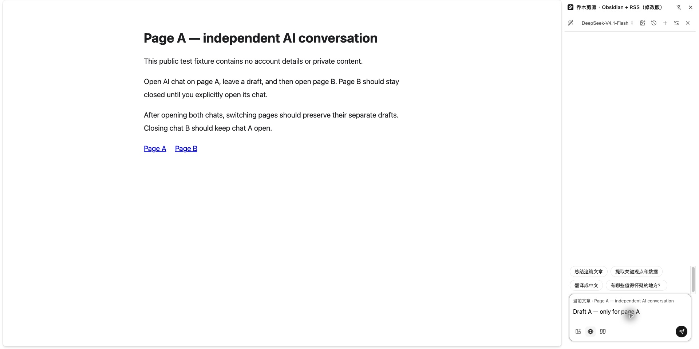
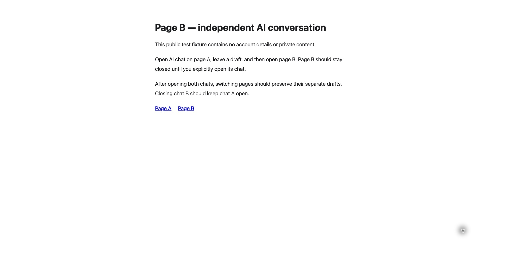

# 按标签隔离 AI 侧栏

## 问题与修复

原入口设置全局侧栏路径并按 `windowId` 打开，侧栏随后监听活动标签变化。因此在 A 页打开 AI 对话后，B 页也会显示侧栏，并把上下文切到 B 页。仅给 `open()` 加 `tabId` 仍不足以修复：没有标签专属配置时，Chrome 会回退到全局侧栏。

本次让 `setOptions()` 与 `open()` 都指定目标 `tabId`，在侧栏 URL 中绑定所属标签；文章读取、导航和关闭事件只跟踪这个标签。后台启动时禁用旧的全局默认侧栏，普通剪藏侧栏也改为显式按标签打开。历史对话的“打开原页面”只为新建的目标标签开启侧栏。

新调用使用 `openAiSidebar({ tabId })`。为兼容已有功能分支，旧的数字参数继续表示 `windowId`，解析该窗口的活动标签后再打开，不把窗口 ID 当成标签 ID。

## 复现步骤

在仓库根目录运行：

```sh
python3 -m http.server 18768 --bind 127.0.0.1 --directory docs/verification/ai-sidebar
```

1. 在新窗口打开 `http://127.0.0.1:18768/a.html`，通过扩展弹窗打开 AI 对话，输入草稿 A，不发送。
2. 新建标签并打开 `http://127.0.0.1:18768/b.html`。B 页不应自动打开 AI 或普通剪藏侧栏。
3. 返回 A 页，侧栏和草稿 A 应仍在。
4. 主动为 B 页打开 AI 对话并输入草稿 B，来回切换应各自保留草稿。
5. 关闭 B 页对话，A 页对话应保持开启；A 页导航时只更新 A 的文章上下文。
6. 在历史对话中打开原页面，检查侧栏只出现在新建目标标签。

## 已执行的验证

- 2026-11-01，独立 PR 分支基于主线 `8e3cac2`：完整前端 **1724 通过、7 跳过**（208 个测试文件），20 项构建工作流测试、18 项注入函数检查通过。
- TypeScript、国际化和商店边界检查通过。4 个相关测试文件共 22 项通过，覆盖目标标签、旧窗口参数兼容、非所属标签事件、导航、关闭及历史跳转。
- 2026-11-01，macOS 日常 Chrome 的已有整合安装版 `1.19.0`，源码指纹前缀 `db660b9a`：重新执行步骤 1–3，取得下方原始截图；不发送模型请求。更早同日整合版本的 Chrome/SunBrowser 验证还覆盖两个侧栏独立草稿与单独关闭。

截图是已有整合安装版的运行证据。独立 PR 已适配主线 `1.19.1` 并执行自动检查；截图不代表独立 PR 构建已重新安装，也不代表 Firefox、Safari 或 Windows 实机验收。

### A 页打开并保留草稿



### 新开的 B 页保持关闭



## 范围

隔离的是侧栏开启状态和所属文章，不改变已有对话存储键、模型配置或会话同步规则。同一 URL 的历史记录仍遵循已有机制。本次未修改模型调用、翻译、划词学习或本地剪藏保存逻辑。
