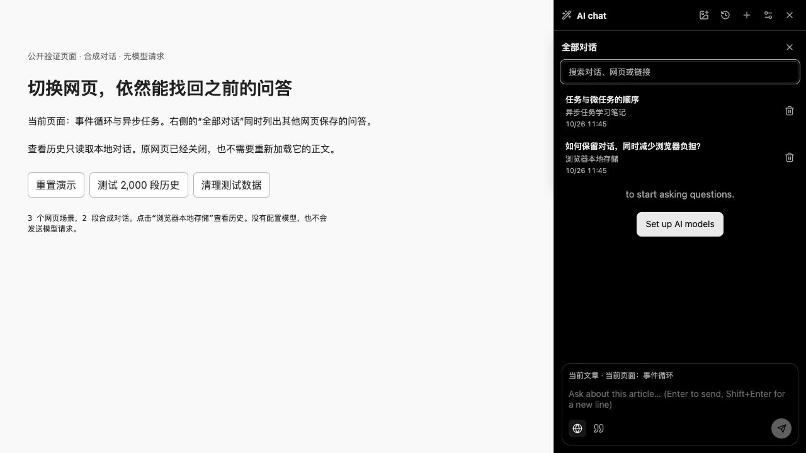
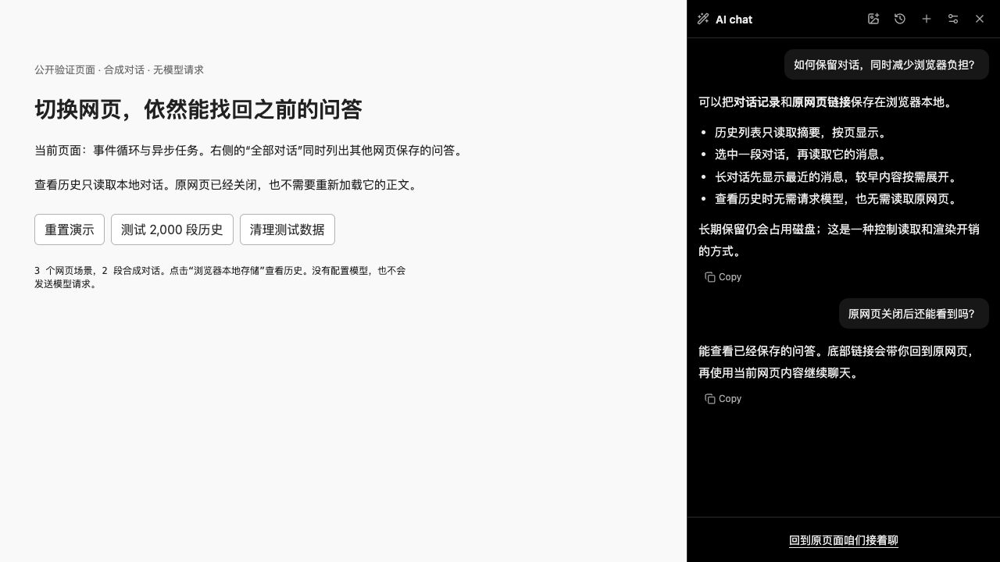

# 跨页面对话历史验证

## 原因与用户看到的变化

旧入口只列出当前网页的对话。用户切换页面或关闭原网页后，难以找到之前的问答；旧存储还分别限制网页数、每页对话数和消息数，保存新内容可能淘汰旧内容。

历史入口现在列出所有网页的对话，可以按问题标题、网页标题和 URL 筛选。选中后只读展示已保存的消息，底部输入框替换为 **“回到原页面咱们接着聊”**。查看无需打开原网页或配置模型；点击链接后才返回来源页面继续。

截图由浏览器实际运行本目录的合成数据页面得到。右侧使用生产 `mountClipChat` 组件；左侧是验证说明，**不是新增的扩展界面**。没有私人聊天、凭证或页面快照。





## 对浏览器负担的考虑

| 环节 | 实现与边界 |
| --- | --- |
| 持久保存 | 使用扩展自身的 IndexedDB，只保存对话字段、来源 URL/标题和索引摘要。不新增原网页 Markdown/HTML/DOM 快照，不复制模型请求里的图片字节。引用、回答和工具结果属于对话内容，仍会保存。 |
| 打开历史列表 | 按最近更新时间读取摘要，每页 40 条，不读取所有对话正文。搜索只扫描摘要，没有全文索引；匹配稀少时可能扫描更多摘要。 |
| 查看一段对话 | 按需加载所选对话，先渲染最近约 40 条消息，再由用户展开较早消息。单个极长对话的数据仍会进入内存，不能称为恒定内存。 |
| 图片和外部请求 | 历史 Markdown 的远程媒体替换为链接，工具图片需主动点击预览；现有本地生成图片在接近视区时才读取。不自动请求模型、读取来源网页或恢复生成任务。 |
| 继续聊天 | 存储保留与模型上下文分开。继续问答只发送最近约 40 条消息及当前网页上下文，不把全部积累历史都发给模型。 |
| 写入与后台 | 在问题提交、回答结束或离开输出中的对话时保存，不随每个输出片段写盘；没有新增轮询、定时后台任务、权限或依赖。写入所选对话的成本仍随其长度增加。 |
| 迁移与失败 | 首次访问执行一次旧存储导入，事务提交后才删除成功导入的旧副本；失败保留旧数据，无法识别的记录保留以便恢复。版本检查和删除标记防止旧窗口覆盖或恢复已删除记录。 |
| 长期空间 | 没有自动淘汰。文本和现有图片图库会逐渐占用磁盘；可以在历史列表删除对话，生成图片沿用现有独立图库管理。卸载扩展或清理浏览器数据仍可能丢失记录。无云同步、无备份保证。 |

## 复现浏览器验证

在源码目录安装项目既有依赖后：

```sh
npm ci
node docs/verification/chat-history/build.cjs /absolute/path/outside-repository/chat-history-fixture
python3 -m http.server 18775 --bind 127.0.0.1 --directory /absolute/path/outside-repository/chat-history-fixture
```

打开 `http://127.0.0.1:18775/`：

1. 历史列表同时显示两个不同来源网页的对话。输入“浏览器”只显示对应记录。
2. 选择“如何保留对话，同时减少浏览器负担？”，确认问答可见、输入框隐藏、底部来源链接正确。
3. 点击“测试 2,000 段历史”，查看页面显示的结果。它创建 2,000 段合成对话，其中一段有 600 条消息；验证列表读取 40 条无正文摘要、该对话初始渲染 40 条消息。
4. 点击“清理测试数据”，清除该 localhost 来源的测试数据库，再关闭服务器。

数据只写入这个 localhost 来源的 IndexedDB，与已安装扩展的数据隔离。页面尝试向同源 `/benchmark` 提交合成性能数值；普通静态服务器不实现该路由也不影响屏幕显示。截图页面不配置模型，浏览器 API 使用 `browser-mock.ts`，因此它验证真实组件渲染和 IndexedDB 性能，**不代表已验证真实扩展的跨标签页接续或远程模型回答**。

## 已记录的合成性能样本

原始数据见 [benchmark.json](benchmark.json)。在本机 Chromium 页面中，2,000 段历史的五次热查询为 0.8–1.3 ms，每次返回 40 条摘要且不含消息正文；列表显示约 15 ms，打开 600 条消息的对话约 12.2 ms，初始渲染 40 条消息，输入框隐藏，远程图片自动加载数为 0。

这些数字是单机合成样本，不是所有设备的性能承诺。UI 耗时包含 `requestAnimationFrame` 轮询，不是首帧跟踪；JSON 中的 `heapBytes` 是整个验证页面的 JS 堆快照，不能当作功能新增内存或整个浏览器占用。

## 自动验证与范围

功能测试覆盖跨页面读取、旧数据迁移和失败恢复、损坏记录保留、分页、并发写入、删除后防恢复、只读限制、来源链接接续、部分输出保存，以及模型上下文窗口和历史保留的分离。

```sh
npm test -- --maxWorkers=1 --no-file-parallelism
npm run test:store-download
npx tsc --noEmit
python3 -m unittest discover -s native -p 'test_*.py'
node scripts/check-i18n.cjs
npm run build
npm run package
```

来源接续在支持原生 sidePanel 的 Chromium 浏览器中通过 session storage 按新标签页 ID 传递对话 ID，校验来源并一次性消费，10 分钟后过期；网站 URL 不携带对话 ID。其他浏览器仍可打开原链接，自动接续能力受侧栏 API 支持限制。

此功能独立基于上游 1.19.0，不带入其他聊天滚动、图片上传、轮次导航或 Token Plan PR。扩展 ID、权限、版本、构建配置和默认模型设置保持上游原样。若这些并行 PR 后续先合并，需重新解决共享聊天文件的合并冲突并回归，当前验证不承诺任意合并顺序自动兼容。


## 删除和清空历史

对话删除现在使用持久清理任务，核对图片引用与图库所有权，并提供失败提示、重开后重试和全部历史清空确认。见 [清理机制、保护边界与真实浏览器验证](cleanup/README.md)。
