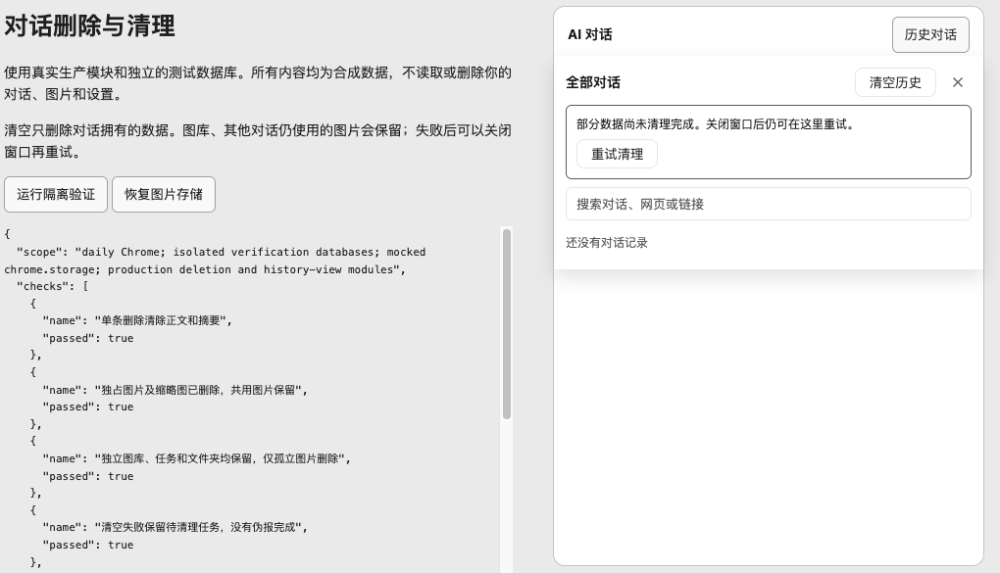

# 对话删除、图片引用与可重试清理

## 原因与行为

对话正文、旧版 `chrome.storage.local` 副本、上传图片和图库原本分开存储。只删除列表/正文，再以 `catch(console.warn)` 尝试清理附件，会留下无法发现、无法继续执行的残留。旧版迁移标记已提交后，旧副本删除失败也不会再次处理。

本次修复使用持久清理任务，提交对话删除和任务记录后再处理跨存储清理。失败后历史入口显示提示与“重试清理”，即使关闭窗口仍保留任务。成功后才删除任务；重试不会重新执行清空历史，因此不会删除失败后新建的对话。

- 单条删除：以完整网页键 + 对话 ID 为边界，删除正文、摘要、相应旧副本及闲置关联图片/缩略图。
- **清空历史**：明确确认后删除所有网页的对话历史和闲置附件，搜索结果不会缩小清空范围。取消和 Escape 不删除数据。
- 共用图片：引用索引核对其他对话，旧格式未迁移记录也受到保护。
- 图库所有权：图库条目和生成任务独立拥有图片，因此保留其图片、条目、任务及文件夹；不删除用户原始文件。只有没有其他引用、图库条目或任务的关联图片副本才清理。不扫描无关图片猜测所有权。
- 多窗口：删除提交后通知其他窗口丢弃已删除对话，取消输出，不再保存陈旧的部分回答。版本检查与删除标记仍阻止陈旧写入。

## 低影响设计与边界

历史数据库从 v1 升级到 v2，增加媒体引用索引和清理队列。升级时逐条补建索引；清空时逐条遍历正文收集 ID，不把所有图片 Blob 加载进内存。列表仍读取摘要，清理只在用户删除、清空、重试，或已有迁移/保存需要移除引用时执行，没有新增轮询、定时后台任务、依赖、权限或模型请求。

这是扩展存储记录的逻辑删除，浏览器决定底层数据库文件何时压缩及回收空间，不是 SSD 安全擦除。保留的删除保护标记只用于拒绝旧窗口写回；图库是独立资产，不随对话删除。无法识别的旧数据采用保守策略，不在单条删除中猜测它属于哪段对话；用户确认“清空历史”时才纳入全部旧历史键。

## 验证

独立 PR：1,651 项扩展测试通过，7 项跳过；19 项构建工作流测试、18 个注入隔离检查、60 项商店边界测试（2 项跳过）、110 项翻译检查、TypeScript 通过。新增测试覆盖事务回滚、清理失败持久化、重开重试、v1 升级索引、同 ID 不同网页、共用附件、图库/任务/文件夹保护、旧副本删除失败、清空后新对话保护及流式输出的删除。

本机集成版本：1,680 项扩展测试通过，7 项跳过；20 项构建工作流测试、TypeScript 和生产构建通过。保留本机此前的 Token Plan、图片上传、滚动和轮次导航功能；这些功能未并入这个独立 PR。

在 macOS 日常 Chrome Default 资料中完成两层验证：

1. 更新后的真实扩展显示“清空历史”，打开确认后点击取消；没有确认删除真实用户数据。
2. 同一日常 Chrome 中运行真实生产清理/历史组件，数据库名、锁名、广播通道加独立测试前缀，`chrome.storage` 使用合成替身。实际点击单条删除、清空取消、清空确认，注入图片存储失败，重新打开页面后实际点击重试。正文和闲置图片/缩略图删除，独立图库、任务与目录保留。详细结果见 `browser-results.json`。

下图仅含合成数据。左侧是验证说明，不是扩展新增界面。



## 复现

在安装依赖后的仓库根目录运行：

```sh
node docs/verification/chat-history/cleanup/build.cjs /absolute/path/to/verification
```

使用 localhost 托管该目录或在自己的测试扩展页面中打开。点击“运行隔离验证”执行六组核验并建立手动测试数据。可点击“模拟图片清理失败”，再从历史列表删除/清空；用 `?restore=1` 重新打开页面，不重置数据库，即可验证待清理任务恢复与重试。

验证器仅操作 `qiaomu-cleanup-verification-chat-*` 数据库。生产数据库、真实 `chrome.storage`、真实模型和用户原网页不在该验证器的访问范围中。结果可选发送至 `127.0.0.1:18774` 的本地记录器；不运行记录器也能在页面查看结果。
