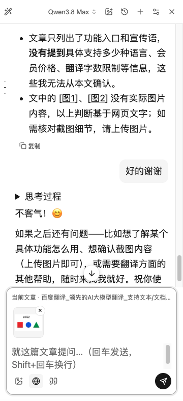

# Chat image attachments

## Why

The chat transport already supports real image input, but the composer only offered images extracted from the current web page. It had no file picker, paste or file-drop path, rejected empty text, and persisted page image numbers without an upload lifecycle. A screenshot on the clipboard could not become a chat message simply by choosing a vision model.

The composer now has one image button. Files can also be pasted into the input or dropped onto the chat panel. Users can inspect/remove thumbnails and send images with or without text. There is no persistent "All images / Text only" selector: page image URLs remain text references and are no longer downloaded or attached automatically. To ask about a page image, attach it explicitly. This is an intentional change to the previous page-image workflow, not just an added button.

## Data and compatibility

- Reuse the existing image decoder, long-image tiling and request limits. At most six files, each at most 12 MiB; aggregate limits are checked again before dispatch. Unsupported, invalid, missing or oversized attachments produce errors rather than silently sending text-only.
- Decode sequentially, wait for an in-progress decode on send, prevent duplicate submission, and cancel pending work when the conversation changes.
- Keep image data and thumbnails in separate extension IndexedDB stores. Conversation metadata stores only opaque attachment IDs and names. Reopening history and later questions hydrate the images for the original turns.
- Delete image data when its last retained reference is deleted or ordinary history limits evict it. Retry uses fresh attachment IDs so delayed cleanup cannot delete the retried upload. History writes in the same extension document are serialized and snapshot message fields before awaiting storage.
- No new permissions, dependencies, model settings or provider-specific API changes. A configured model still needs vision support. This is local persistence, not cloud sync or a global cross-page history UI.

## Reproduction

Use a public page such as <https://fanyi.baidu.com/> and the [public sample image](chat-images/sample.png).

1. Open AI chat and click the image button. Choose the sample. Confirm the preview and remove button; the old page-image selector should be absent.
2. Send the image with an empty text field using a vision-capable model. It should receive actual image bytes, not just a filename. The sample contains `L9Q2` and three colored shapes.
3. Ask a follow-up, then close/reopen the chat history and ask about the image again without uploading it a second time.
4. Paste a screenshot, or drop multiple local images. Confirm previews, removal and mixed text/image sending.
5. Try an invalid file, cancel while decoding, and retry a failed image request. There must be no stale upload in the new conversation and no silent text-only fallback.

## Evidence

This direct macOS Chrome capture shows the installed integrated build on the public page above, after choosing the sample with the real file picker. The draft was removed after capture. The installed build also contains separately proposed scrolling, navigation and provider changes; the screenshot is not an isolated-branch GUI or cross-browser test.

Prior installed-build checks confirmed actual image-only input, macOS screenshot paste and history follow-up with Qwen and DeepSeek. Those provider checks are not repeated as a claim about this independent PR. Its automated tests mount the real composer/chat component and exercise picker/paste/drop, image-only/mixed input, follow-up and remount hydration, early sending, duplicate submission, cancellation, invalid files, size/count limits, retries and attachment cleanup with fake IndexedDB. Browser decoding is mocked in those component tests; a native Finder drag operation was not independently repeated.
