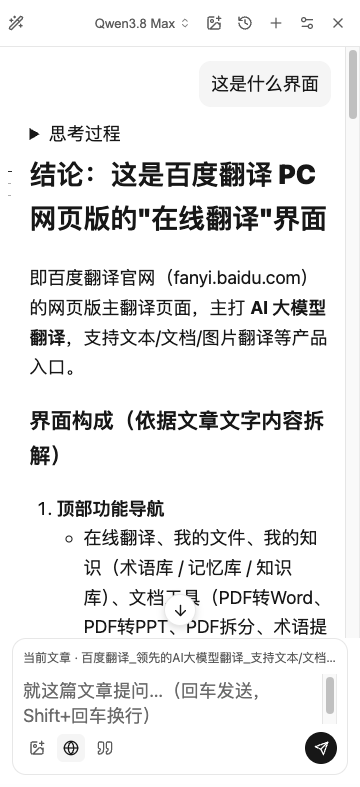
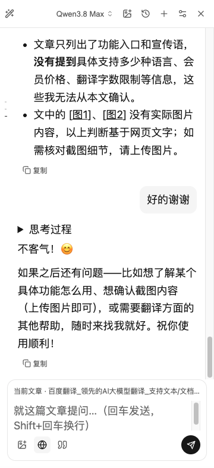

# Chat reading position

## Problem and change

Sending a follow-up while reading an older answer used to jump to the end. Each streamed update and the final completion repeated that jump, so scrolling up during generation was ineffective. The cause was unconditional writes to the message viewport's `scrollTop`, rather than a limitation of streaming or the model.

Sending, streaming, tool updates, stopping and errors now preserve the reader's position. A small bottom-arrow button appears when more content is below the viewport. Clicking it performs one jump; it does not enable automatic following. Opening a saved conversation still starts at its latest message. Completion does not steal focus from a reader interacting with an older message.

The content wrapper lets `ResizeObserver` notice delayed image/tool growth as well as viewport resizing without scrolling. The observer is disconnected on destruction.

## Reproduce in the extension

1. Open a public page, for example <https://fanyi.baidu.com/>, and open AI chat.
2. Ask for a long explanation, then scroll to an early paragraph.
3. Send a follow-up. The same paragraph must stay visible.
4. Scroll farther up while the reply is streaming. Later chunks, completion, stopping or an error must not move the viewport back down.
5. Click the bottom arrow. The latest message becomes visible and the arrow disappears. Later content growth may reveal the arrow again, but must not start following automatically.

## Real Chrome screenshots

These are direct captures of the installed extension on the public page above, showing an earlier answer and the result of clicking the arrow. This installed build also has separate image attachment, navigation and provider changes; those controls are **not part of this PR**. The screenshots illustrate the real extension UI, not an isolated-branch or cross-browser test.

| Reading an earlier answer | After explicitly jumping to the latest message |
| --- | --- |
|  |  |

## Automated coverage

`clip-chat-scroll.test.ts` mounts the real chat component and drives sending, streamed text/tool callbacks, stopping, errors, reopening, content growth and viewport resizing. It records programmatic scroll writes and checks focus preservation, button visibility and observer cleanup. jsdom does not implement browser layout; the test supplies viewport dimensions and native-style clamping. The screenshots and manual checks cover the installed browser UI separately.
