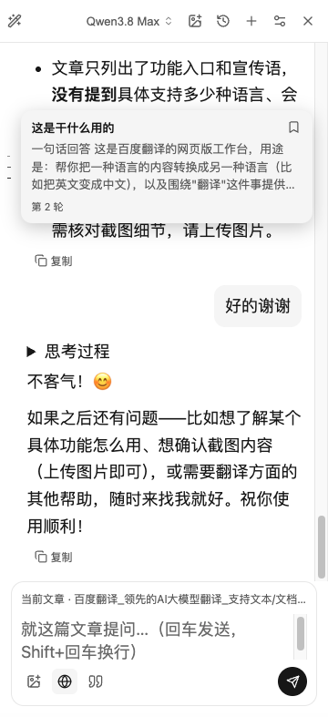
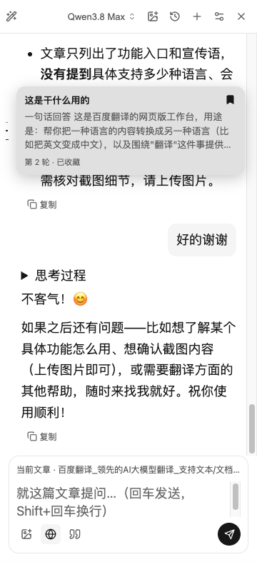

# Turn navigation and bookmarks

## Problem and behavior

In a long conversation, finding an earlier question requires repeated scrolling. The current reading location and an intentionally saved question are different states and need different indicators.

The left edge now has one short grayscale line per user question, in conversation order. Hover/focus opens a question and answer excerpt; clicking the line or preview jumps to that question. The preview's bookmark button saves a complete question/answer turn without jumping. The current location uses a longer thin line; a bookmark uses a stronger two-pixel line and a filled bookmark icon in the preview. Both states can coexist.

- Markers append at a fixed pitch instead of being redistributed from top to bottom. Each retains its original question/answer references while later messages stream or append.
- Start below the upper sixth of the message area, with another 20px offset, and end 16px above its bottom. The composer is excluded from that area.
- Lines adapt to panel width (roughly 3–6px), with no dots or colored accents. Hide navigation below 340px and restore it when widened. The rail can scroll for long conversations.
- Keyboard exploration uses Up/Down, Home/End, Right to reach bookmarking, Enter/Space to activate, and Escape to dismiss. Hovering and bookmarking never scroll the conversation. Reduced-motion and coarse-pointer styles are included.
- Bookmark metadata is saved in existing local history. Retain the bookmarked question and its complete answer beyond ordinary message/conversation/article limits. Unbookmarking restores ordinary retention; explicit deletion still deletes the conversation.
- Navigation owns its observers and can mount around the existing message viewport by itself. It reuses the scroll feature's wrapper if present. It does not require the separate scrolling, image attachment or Token Plan PRs.

## Reproduce

On a public page such as <https://fanyi.baidu.com/>, open AI chat and ask three questions with sufficiently long answers.

1. Hover each line: its question and answer must match its fixed position in the sequence.
2. Append another question and stream its reply. The earlier lines must not move to evenly distributed positions or show the new reply.
3. Click an earlier line and scroll through the answer. The current-location indicator must follow the viewport.
4. Hover a different line and bookmark it. The bookmark and current-location indicators must remain independent; the viewport must not jump.
5. Reopen the history and verify the bookmark, then narrow/widen the panel. Keyboard navigation and save failure/retry should remain usable.

## Real Chrome screenshots

| Hover preview while reading the third turn | Bookmark the second turn without changing reading position |
| --- | --- |
|  |  |

These direct captures show the already installed integrated Chrome extension on the public page above. The temporary bookmark was removed after capture. The image button, scrolling and provider features visible in that installed build are separate changes; these are not screenshots of the standalone PR branch or evidence of Firefox/Safari GUI acceptance.

## Tests and limits

Navigator tests cover stable binding, appending/streaming, current location, width changes, hover transitions, safe text previews, bookmark rollback/retry, keyboard behavior, explicit jumps, removal/reset and teardown. The standalone-wrapper test checks observer-driven streamed content updates and restoration of the original viewport. A chat-component integration test drives real turn registration, streaming, persistence callbacks and remount restoration. Storage tests cover bookmarked retention, unbookmarking, deletion and overlapping writes.

jsdom tests provide viewport dimensions rather than proving native layout. Real Chrome captures cover the installed UI separately. History stays local and page-scoped; this PR does not add global history browsing or cloud synchronization. Bookmarked history can grow beyond ordinary retention limits until explicitly removed.
