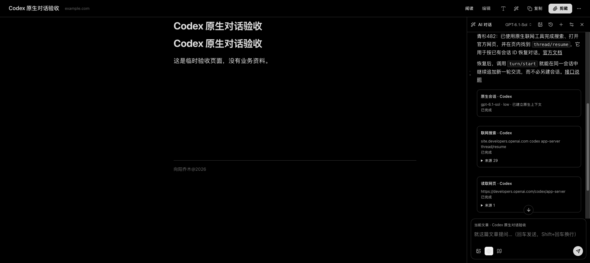

# Codex 原生网页对话验证

## 分支与依赖

本功能基于主线 `8e3cac2`，并包含 [#106 完整模型上下文](https://github.com/joeseesun/qiaomu-clipper/pull/106) 的独立前置提交。官方线程接续依赖完整用户消息前缀；主线旧的历史裁剪会导致长对话失去正常接续，因此应先合入 #106。原生功能与前置改动分开提交，未打包其他待合并功能。

## 自动检查（2026-11-01）

- 完整前端：**1736 通过、7 跳过**，213 个测试文件。
- 构建工作流 20 项、注入函数隔离 18 项通过。
- TypeScript、国际化、商店边界检查通过。
- 完整原生助手：**244 项通过**，其中新增 Codex 助手 9 项。覆盖官方线程接续、输入与账号/模型/档位校验、工具限制、代理继承、取消，以及输入流/子进程输出流未关闭或只有半条消息时的退出回收。
- 前端定向回归覆盖真实工具事件、来源归并、长过程与最终回答分离、异常断开、取消，以及原生静默超过 3 分钟仍可继续等待。

以上为独立 PR 分支的自动检查。管道和官方协议测试使用模拟运行时，不能替代真实账号和浏览器验证。

## 已有真实运行证据

2026-10-31 在 macOS SunBrowser 的整合安装版 `1.19.0` 上使用 Codex CLI `0.162.1` 验证：

1. 使用所选模型，low/high 思考档位按用户选择传递。
2. 一轮实际收到 4 次搜索、3 次网页打开、1 次页内查找完成事件；工具卡显示相应来源。
3. 关闭页面后重新打开、调整思考档位并追问，仍能续接此前线程中的测试暗号与实际访问网址。
4. 搜索中停止恢复可发送状态，未完成工具标记为中断；连接失败如实显示，重试成功。
5. 后续修复 Python 读取线程未回收导致的退出崩溃，通过停止标志、OS 管道读取与线程回收处理半帧和未关闭流。

下图来自上述整合安装版，使用可公开的测试内容与官方文档；保留原图。它展示真实工具与来源，但不宣称独立 PR 基于 `1.19.1` 的构建已重新安装。此 PR 保留主线逐请求模型/档位传递和 #106 的上下文/输出预算逻辑，并增加 Windows 测试收集兼容；未重新发起计费模型验收。

## 复核步骤

按[安装说明](../../../native/CODEX-CHAT.md)注册助手并确认 CLI 版本。打开公开文章，选择与本机登录一致的 Codex 账号、可用模型和档位，要求对公开官方文档进行多次独立搜索、打开和页内查找。检查工具卡与实际来源，再追问前轮内容、关闭重开后追问，并在另一轮生成中点击停止。

验证时不上传账号令牌、完整原生日志、私人文章或本地代理配置。当前交付范围是 macOS Chrome/SunBrowser；不宣称 Windows、Linux 或其他浏览器实机通过。官方服务额度、权限和上下文限制继续生效。
