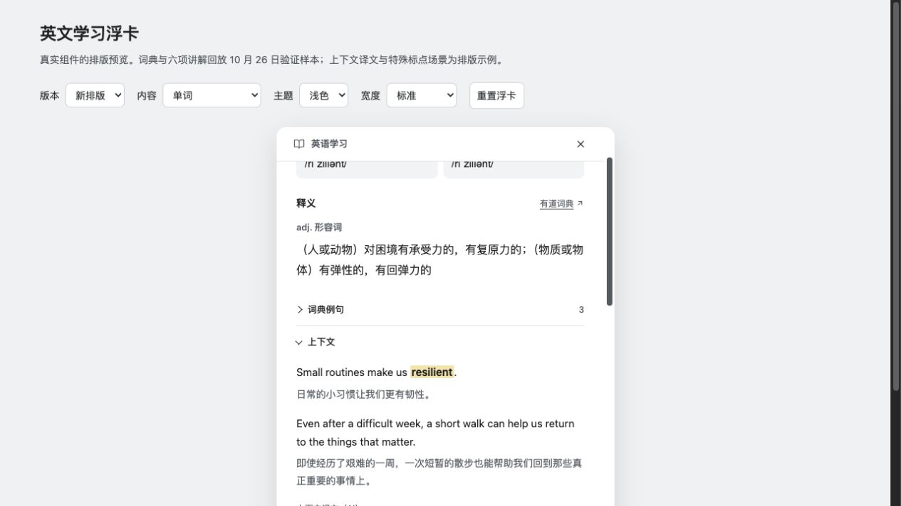

# 英文划词学习的验证与边界

原网页和阅读器选中英文后可打开学习卡。词典资料先展示；深入学习和展开上下文按需使用 AI 对话保存的模型。六项讲解沿一条阅读顺序展开，语境按一句英文、一句中文配对，学习词突出显示。

## 复现

1. Chrome 加载本分支商店版构建；打开包含 `Small routines make us resilient.` 的普通公开测试页。
2. 选择 `resilient`，点击翻译；核对有道词典释义、英美音标及来源链接。
3. 展开上下文或点击深入学习，核对原句与对应译文、六项完整教学字段。修改 AI 对话模型后重新生成应跟随新选择。
4. 检查整句合成朗读、无模型设置入口、请求取消与重试；关闭后能继续选择原文。

公开图片为生产组件的合成数据回放，不是新的扩展独立分支实机验收截图。此前集成安装版已在 Chrome 原网页实际划词、查询词典并调用模型验证；原始实机截图包含个人浏览器上下文，保留在本地，没有随 PR 上传。该集成版的英文模块与本分支对应代码一致；上游基线与其他功能有所不同，两类证据不能混为一谈。

已记录的实机样例：单词与整句、两组/一组英中对应，以及原网页三句上下文逐句对应。480/360/280/220px、明暗主题、无横向溢出、停止与无响应恢复通过组件回放。语义核对只覆盖这些样例，不保证模型每次都正确。

查词只将选词发送给有道；AI 学习只在用户请求时将选文、附近上下文、标题及已有词典依据发送给已配置模型。账号凭据不交给网页。缓存有数量和时间上限，使用浏览器会话存储；关闭浏览器不保留长期词库。公开词典接口及系统本地英语语音依赖外部可用性，缺失时明确提示。

选择范围为 1–1500 字符，附近语境最多 3000 字符；本功能是局部英语学习，不替代全文翻译。Chrome 已有实机记录，Firefox/Safari 的原网页入口仍需分别适配和验收。词典英美音频与系统整句合成朗读明确区分。
