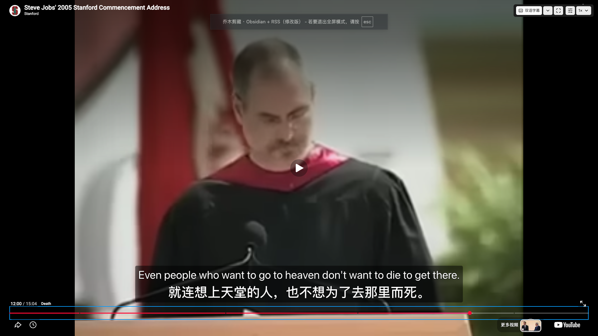
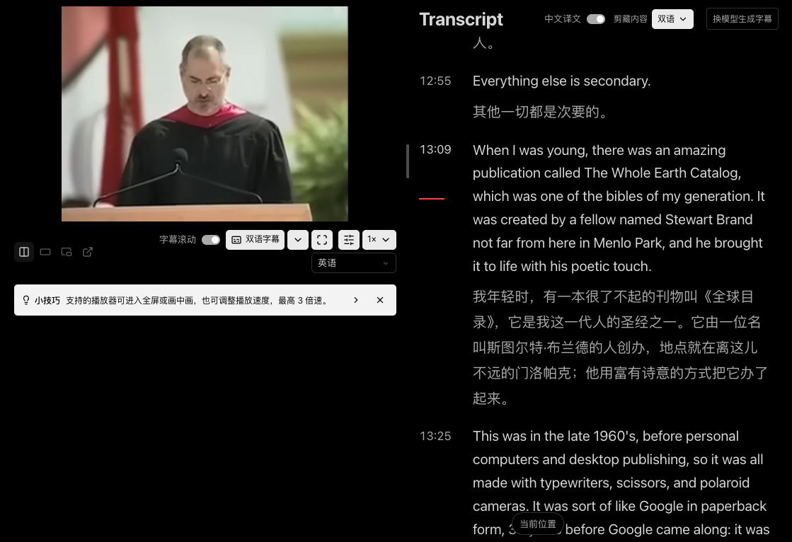

# 沉浸学习：全屏字幕、控件对比度与双语文稿

本次修复三个可以分别触发的问题：

- YouTube 原生全屏只带入 iframe，扩展字幕位于外层，因而消失。
- 深色主题没有定义控件使用的背景变量，按钮回退为浅色背景，却继续使用浅色正文；“小技巧”也受影响。
- Chrome 整页翻译将文稿英文原文及已有中文译文再次改写，双语开关开启时出现两段中文，菜单文字也可能被误译。

## 实现边界

嵌入播放器与扩展父页完成握手后，原生全屏按钮、F 键和视频双击请求统一让包含字幕的外层播放器进入全屏。消息校验父窗口／iframe 与来源；输入区域、组合键、其他控件和连续按键不会重复触发。卸载时撤回拦截。普通 YouTube 网页及其他站点的播放器不启用这条路径。

学习控件明确配对浅色背景与深色文字，保留“双语字幕”的选中状态。颜色规则限制在阅读器，覆盖字幕菜单、样式面板、倍速、文稿剪藏菜单及小技巧。

学习路由在渲染前声明 `translate="no"` 与 `notranslate`；阅读器重建页面时保留语言及翻译语义属性，避免初始声明被清理。学习文章也独立声明保护，覆盖预览和原页阅读入口。扩展自己的模型翻译仍按原有开关工作；普通文章路由不会被统一禁用网页翻译。

## 实机证据

2026-10-28，在 macOS Chrome 155 已安装的集成测试版完成以下验证。公开测试视频为 [Stanford 的 Steve Jobs 2005 年毕业演讲](https://www.youtube.com/watch?v=UF8uR6Z6KLc)。没有模拟 Fullscreen API、字幕返回或浏览器翻译结果。

| 场景 | 实际结果 |
| --- | --- |
| 原生全屏按钮、F 键、真实双击 | 进入外层播放器全屏，中英字幕保留；真实双击事件 `isTrusted=true` |
| 原生按钮退出、F 退出、Escape | 能退出全屏并恢复普通布局 |
| 字幕开关关闭后进入全屏 | 保持关闭，不强制开启字幕 |
| 全屏播放 | 播放时间推进，字幕正常显示 |
| 深色与浅色控件 | 菜单、字幕样式、倍速、小技巧可读；全屏工具栏同样可读 |
| Chrome 整页翻译开／关对照 | 修复前恢复“英语”立即恢复英文原文＋中文译文 |
| 修复后再次选择中文网页翻译 | 57 段原文逐段与操作前完全一致，57/57 段译文就绪，原文保持英文 |
| “中文译文”开关 | 关闭时保留原文，开启后恢复原文＋中文 |
| “剪藏内容”菜单 | 跟随文稿、原文、中文、双语四项正常，能够选择双语 |

全屏状态下字幕和工具栏同时可见：

文稿保持英文原文与中文译文，浅底控件和小技巧使用可读文字：

两图均来自实际安装运行；全屏图为先前全屏／配色修复验收时的画面，文稿图为本次包含语言保护修复的画面。文稿图直接截取产品内容区域，排除浏览器标签、账户与对话侧栏。它们记录集成测试版的实机行为，不代表这个独立 PR 分支重新安装后的完整验收。

## 复验方法

1. 构建并加载扩展，在上述 YouTube 视频进入“沉浸学习”，开启播放器中文字幕，选择双语字幕；先确认当前字幕已翻译。
2. 分别使用播放器原生全屏按钮、F 键、双击进入全屏，检查同一句原文与译文；再用按钮、F、Escape 退出。关闭字幕后重做一次，检查关闭状态不变。
3. 在深／浅主题分别打开字幕显示菜单、字幕样式、倍速和剪藏菜单，并检查小技巧与全屏工具栏。
4. 开启文稿“中文译文”。用 Chrome 地址栏翻译菜单切换英语／中文（简体），检查原文、译文和菜单仍保持正确语言。
5. 关闭再开启“中文译文”，确认原文不丢失；在“剪藏内容”中选择双语。

自动回归可运行 `npm test`；重点文件是 `player-fullscreen.test.ts`、`embedded-player-interaction.test.ts`、`player-caption-interaction.test.ts`、`youtube-translation.test.ts` 和 `transcript-export.test.ts`。自动化验证事件路由与文稿逻辑，真实浏览器的用户激活、整页翻译与颜色显示仍需上述实机复验。

## 已知限制

- 仅 macOS Chrome 完成上述实机验证；Firefox、Safari、Windows 的真实全屏行为尚未复验。
- YouTube 有多套内嵌控件，本次覆盖实测的新控件与传统 `.ytp-fullscreen-button`。站点未来改变结构仍可能需要适配。
- 部分 YouTube 控件在外层容器全屏时仍显示“进入全屏”的原生标签；再次点击能够退出。未重写第三方播放器的内部全屏状态或强行同步其按钮文案。
- 原文保护不校验模型译文的语义准确度；字幕翻译仍依赖已配置的模型与网络。
