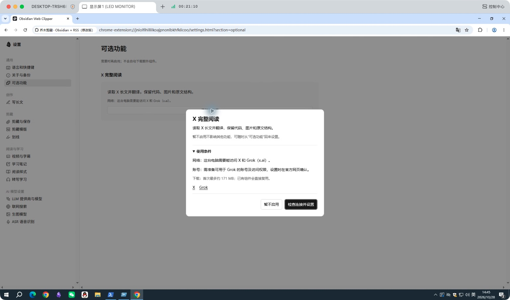

# Windows 助手验证与发布边界

2026-10-28 在 Windows x64、Chrome 独立测试配置及包含中文/空格的测试库完成下列验证。系统没有可用 Python 或 Python launcher，安装与执行使用助手自带 Python 3.12.16。X/Grok 网络不可用，因此相关联网部分明确待测。

## 身份与可复核范围

实测助手为 1.16.13，扩展为 1.19.0 集成测试版。未签名 EXE 的 SHA-256 为 `0a018724079a4bd46a9c6df5382dbec257ad5adefc37f2ab8569bb35bd03f7d6`。候选交付 254 项文件校验一致，已安装的 15 个源码文件与该候选逐一一致。

本 PR 从最新 main 重新整理，不能将旧集成包描述为新分支安装包。涉及助手和安装器的代码与实测源码逐字节一致，文件清单见 [tested-source-hashes.json](x-helper/tested-source-hashes.json)；公开报告只提供身份、方法与结果，原始本机日志、配置备份和完整个人浏览器截图不上传。原验证集还包含独立提交的正文列表修复，那个结果不归属于本 PR。

## 已实际完成

|流程|结果|
|---|---|
|升级|1.16.11 → 1.16.12 静默安装，以及 1.16.12 → 1.16.13 GUI 取消/重新安装通过；配置、浏览器配对、笔记和已有私有组件环境保留；旧包在自检成功后移除。|
|卸载与重装|插件打开 Windows 系统卸载器；取消后仍可用，确认后注册、助手及私有环境移除；GUI 干净重装后恢复连接。|
|数据保留|卸载/重装前后测试库文件哈希一致，1.6 GB 共享模型缓存保留。卸载会清除助手设置，重装后重新确认库；不承诺保留被明确卸载的设置。|
|本地笔记与附件|真实 GUI 保存网页/日记，中文路径附件选择、取消、草稿恢复通过；5,580,000 字节附件落盘后 SHA-256 与源文件一致。|
|保存协议|创建、重名保留、幂等重试、追加、前置、覆盖、日记及 PDF 附件通过；非法路径、错误扩展来源和跨库请求被拒绝。|
|原有离线功能|网页读取、编辑、复制粘贴、Markdown 下载/保存、模板匹配、设置导出导入、写作草稿恢复及导入导出通过。|
|可选 X|已查看使用条件、网络/账号要求、下载体积和“暂不启用”；未安装 Grok，没有创建安装任务。|
|本地字幕|干净重装后，通过真实 `asrInstall` 从已校验官方 wheel/模型缓存安装完成；私有 `msvc-runtime` 自动提供 C++ DLL，系统目录仍无对应 DLL。|
|真实识别与 UI|13.2 秒中文 WAV 经实际 FFmpeg 与 faster-whisper 生成 3 段字幕，播放跳转、刷新恢复、下载和保存通过。专有名称存在识别错误，不宣称逐字准确率 100%。|

最终 Windows 原生回归运行 268 项：263 通过、5 项按平台跳过，0 失败。跳过项涉及 POSIX/macOS 及需要额外权限的文件符号链接；目录 junction 逃逸另有覆盖。首次测试中的 macOS 复制夹具和漏带安装器测试材料已修正后全量复跑。字幕首次验证暴露的私有 C++ DLL 缺失是产品问题，已在干净重装后验证修复。

## 尚未完成

- Windows X/Grok 下载、官方登录、联网取得全文与全文翻译。
- 字幕组件从公网首次完整下载：曾长时间停留在依赖下载，取消与恢复通过；缓存安装与真实推理不能代替公网首次下载。
- Windows ARM64、其他 Windows 配置及 Chrome 商店分发。
- 各外部 AI、搜索、生图、云识别、外站媒体下载等真实账号服务端成功路径。
- 发行签名、公证和 GitHub Releases 正式发布。

## 维护者复验

构建对应架构安装器，在无系统 Python 的测试用户下安装，确认扩展检测和 Native Messaging 自检；选择含中文/空格的测试库，创建笔记并记录哈希。升级后核对配置、附件、已有组件环境，再分别验证卸载取消、确认卸载、重装与重新选库。另在能够访问 X/Grok 的环境完成组件下载、登录、真实长文、断网/取消/重试测试。

构建方法和启用正式下载入口的顺序见 [安装与发行](../../native/X-HELPER-SETUP.md)。本报告不是正式安装包的签名或上线批准。
